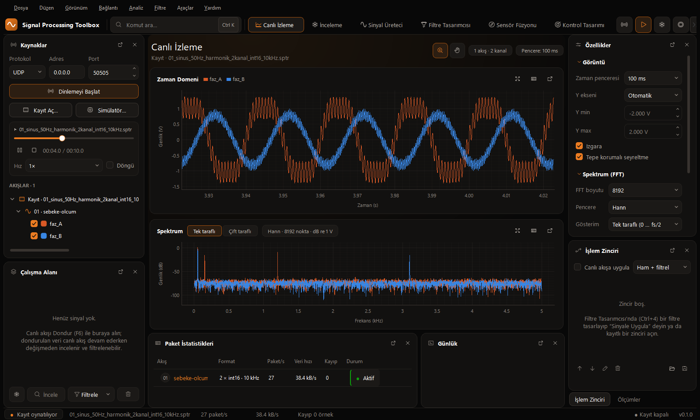

# Sinyal İşleme Stüdyosu

Gömülü sistemler için gerçek zamanlı sinyal analizi ve kontrol tasarımı masaüstü uygulaması.

> **Geliştirme aşamasında.** Özellikler ve belgeler değişebilir.



## Ne yapar

Karttan gelen veriyi canlı izler; üzerinde filtre, sensör füzyonu ve kontrolcü tasarlar; sonucu STM32'de çalışacak
C koduna dönüştürür. Kısacası: **İzle → Tasarla → Aktar.**

| Bölüm | İçerik |
|---|---|
| Canlı İzleme | Ethernet (UDP), USB ve CAN akışları; zaman ve frekans grafikleri; kayıt ve oynatma |
| Sinyal Üreteci | Dalga tasarımı, DAC nicemleme analizi, C kodu; Ethernet ile karta anında gönderme |
| Filtre Tasarımcısı | IIR, FIR ve özel filtreler; canlı akışa uygulama |
| Sensör Füzyonu | Mahony, Madgwick, Kalman, EKF, UKF ve parçacık filtresinin karşılaştırması |
| Kontrol Tasarımı | Sistem tanımlama, PID, durum uzayı, MPC ve blok diyagram |

## İlk donanım testi

NUCLEO-F429ZI üzerinde: arayüzde tasarlanan sinyal Ethernet (UDP) ile karta gönderilir; kart onu derleme ve yükleme
olmadan DAC1'den (PA4) üretir. Örnek proje: [`stm32f4_examples/001_signal_generator`](stm32f4_examples/001_signal_generator).

## Kurulum

Python 3.14 gerekir.

```
git clone https://github.com/LoopOverlord1453/sinyal-isleme-studyosu.git
cd sinyal-isleme-studyosu
py -3.14 -m venv .venv
.venv\Scripts\python -m pip install -r requirements.txt
py run.py
```

## Yol haritası

- [ ] Kart tarafında USART, USB ve CAN-bus desteği
- [ ] Filtre, sensör füzyonu ve kontrolcü için MISRA C:2012 uyumlu C11 kod üretimi
- [ ] Donanım döngüde test: kartta çalışan algoritmanın sonucunu stüdyoda anlık izleme
- [ ] Karttan alınan ölçümlerle sistem tanımlama
- [ ] Üretilen kod için işlem süresi ve bellek tahmini
- [ ] Daha geniş STM32 desteği (Cortex-M0+, M3, M4F, M7)

## Belgeler

Kılavuz, protokol tanımları ve örnek projelerin belgeleri [`docs/`](docs) klasöründedir (Word). Başlangıç için
`SPT-GEN-001_Sinyal_Isleme_Studyosu_Kilavuzu.docx`.

## Lisans

[LGPL-2.1](LICENSE)
