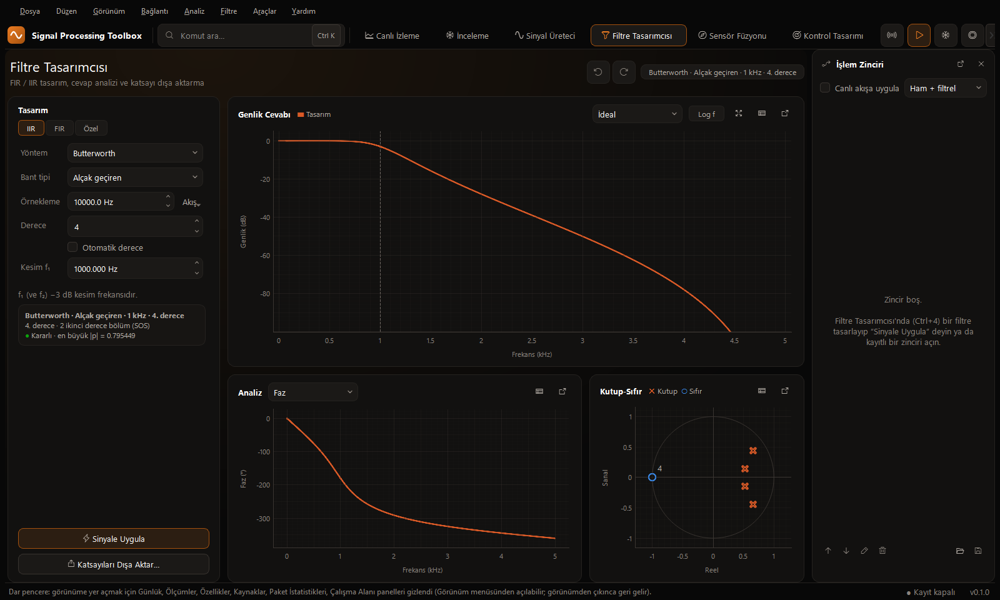
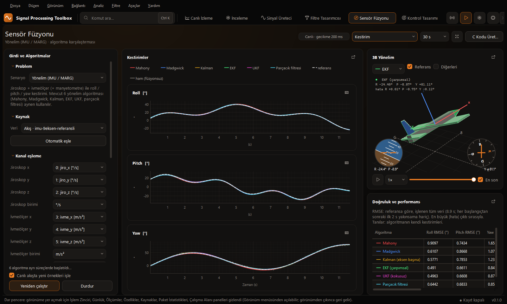
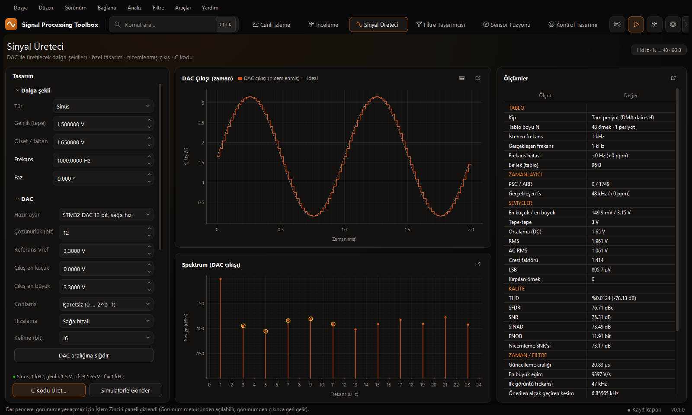
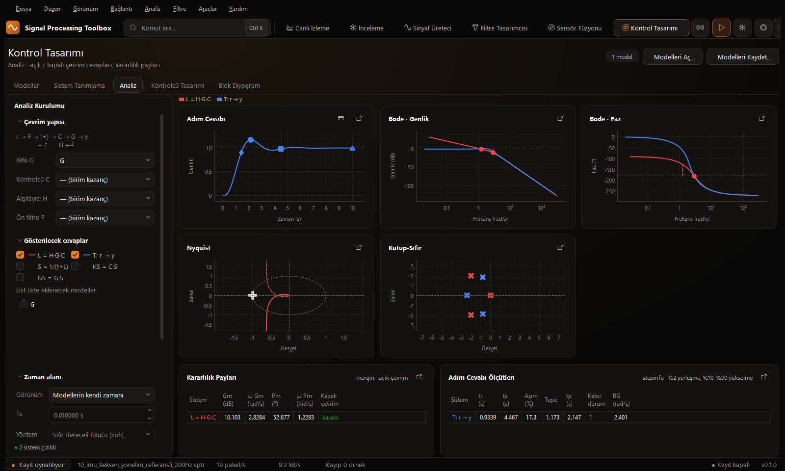
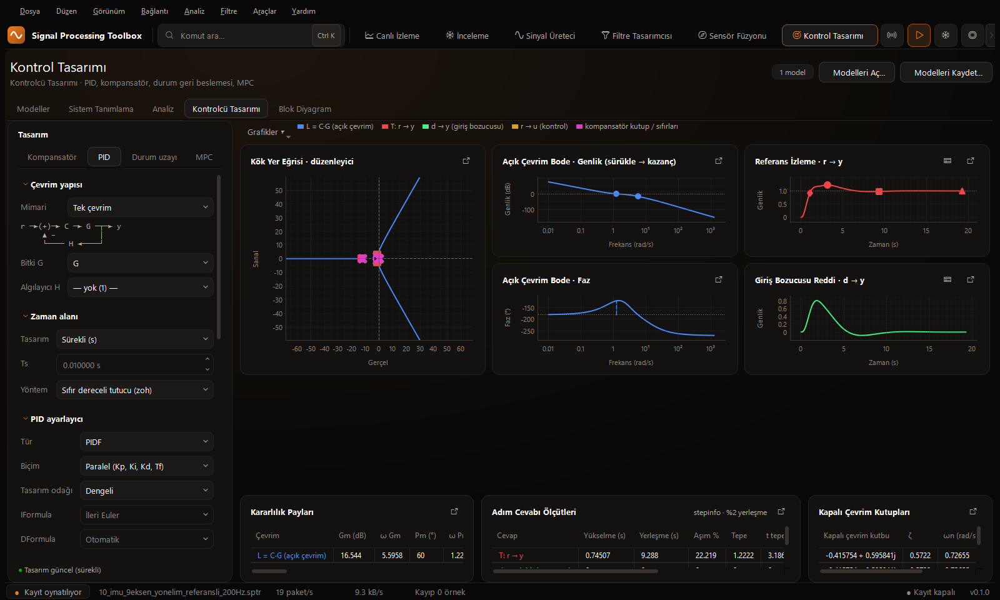
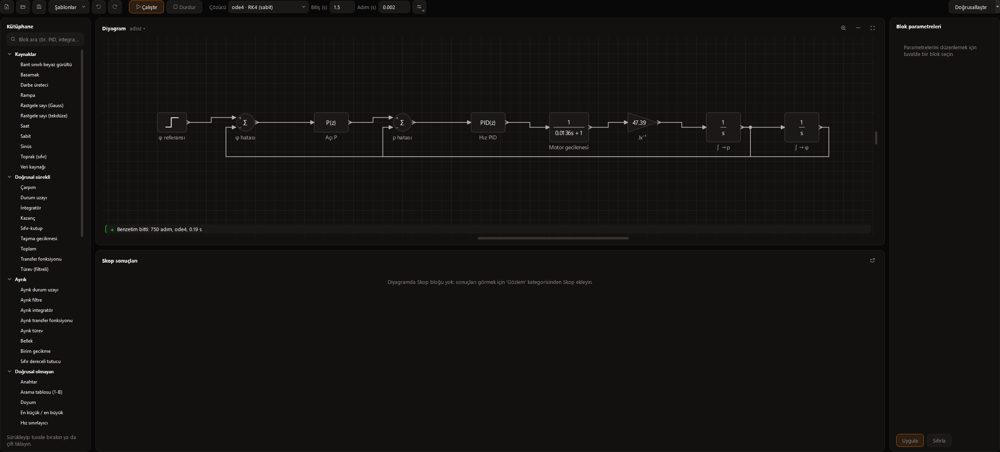

# Sinyal İşleme Stüdyosu

Gömülü sistemler için gerçek zamanlı sinyal analizi ve kontrol tasarımı masaüstü uygulaması.

Kartınızdan Ethernet (UDP) üzerinden gelen veriyi canlı izler, spektrumunu çıkarır, filtreler, sensör
füzyonu ve kontrolcü tasarlar; sonucu mikrodenetleyicide çalışacak C koduna dönüştürür.


## Ne işe yarar

Gömülü geliştirmede algoritma genellikle bir araçta tasarlanır, veri başka bir araçla izlenir, C kodu
elle yazılır. Bu uygulama üç adımı tek pencerede toplar:

1. **İzle** — karttan gelen ham veriyi kayıpsız al, kaydet, yeniden oynat.
2. **Tasarla** — filtreyi, füzyon algoritmasını veya kontrolcüyü gerçek veri üzerinde dene.
3. **Aktar** — tasarımı C kodu olarak dışa aktar ve karta göm.

## Özellikler

| Bölüm | İçerik |
|---|---|
| Canlı İzleme | Çok akışlı UDP alıcı, zaman ve frekans grafikleri, kayıp sayımı, `.sptr` kayıt ve oynatma |
| İnceleme | Canlı akışı dondurup anlık görüntü üzerinde ölçüm ve filtreleme |
| Sinyal Üreteci | Standart ve özel dalga şekilleri, DAC nicemleme analizi (THD, SNR, ENOB), C tablosu üretimi |
| Filtre Tasarımcısı | IIR, FIR ve özel filtreler; genlik, faz, grup gecikmesi, kutup-sıfır; canlı akışa uygulama |
| Sensör Füzyonu | Yönelim, irtifa ve 2B konum senaryoları; altı algoritmanın referansa göre karşılaştırması |
| Kontrol Tasarımı | Model çalışma alanı, sistem tanımlama, analiz, PID / kompansatör / durum uzayı / MPC, blok diyagram |
| Kod Üretimi | Filtre, füzyon, kontrolcü ve MPC için mikrodenetleyici C kodu; işlem maliyeti tahmini |

## Ekran görüntüleri

### Filtre Tasarımcısı

Yöntem, bant tipi ve derece seçilir; genlik cevabı, faz ve kutup-sıfır diyagramı anında güncellenir.
Tasarlanan filtre tek tıkla canlı akışa uygulanır veya katsayıları dışa aktarılır.



### Sensör Füzyonu

Mahony, Madgwick, Kalman, EKF, UKF ve parçacık filtresi aynı veri üzerinde yan yana çalışır. Kayıtta
referans yönelim varsa her algoritmanın hatası (RMSE) tabloda gösterilir; seçilen algoritma C koduna
dönüştürülür.



### Sinyal Üreteci

DAC ile üretilecek dalga şekli tasarlanır. Nicemlenmiş çıkış, spektrumu ve kalite ölçüleri gösterilir;
tablo ve zamanlayıcı ayarları C kodu olarak alınır.



### Kontrol Tasarımı — Analiz

Açık ve kapalı çevrim için adım cevabı, Bode, Nyquist ve kutup-sıfır grafikleri; kararlılık payları ve
adım cevabı ölçütleri.



### Kontrol Tasarımı — Kontrolcü

PID ayarlayıcı, kompansatör, durum geri beslemesi ve MPC. Kök yer eğrisi, açık çevrim Bode ve kapalı
çevrim cevapları tasarım değiştikçe güncellenir.



### Kontrol Tasarımı — Blok Diyagram

Sürükle-bırak blok diyagram düzenleyici, benzetim ve doğrusallaştırma. Dörtrotor ve sabit kanat için
hazır otopilot şablonları bulunur.



## Kurulum

Python 3.14 gerekir.

```
git clone https://github.com/LoopOverlord1453/signal-processing-studio.git
cd signal-processing-studio
py -3.14 -m venv .venv
.venv\Scripts\python -m pip install -r requirements.txt
```

## Çalıştırma

```
py run.py
```

`run.py` dosyasına çift tıklamak da yeterlidir; uygulama kendini proje ortamıyla (`.venv`) yeniden başlatır.

### Kart olmadan denemek

`samples_signal_data/` klasöründe 13 örnek kayıt bulunur: şebeke ölçümü, IMU, 24 bit ses, I/Q, EKG,
kayıplı akış ve referanslı füzyon verileri. Kaynaklar panelinden **Kayıt Aç…** ile açılır.

Alıcıyı gerçek ağ yolu üzerinden sınamak için bir kaydı UDP ile gönderebilirsiniz:

```
.venv\Scripts\python -m spt.sources.simulator --file samples_signal_data\01_sinus_50Hz_harmonik_2kanal_int16_10kHz.sptr --loop
```

Kayıtların ayrıntısı: [samples_signal_data/README.md](samples_signal_data/README.md)

## Kartınızı bağlamak

Cihaz, veriyi **SPTF** adlı ikili çerçeve formatında UDP ile (varsayılan port 50505) gönderir. Format
kendini tanımlar: örnekleme hızı, kanal sayısı, veri tipi, birim ve ölçek akışla birlikte gelir; bu
yüzden arayüzde ayrıca yapılandırma gerekmez.

| Özellik | Değer |
|---|---|
| Çerçeve türleri | Tanımlayıcı, veri, olay işareti |
| Veri tipleri | 17 tip: 8–64 bit tam sayı, 24 bit paketli, float16/32/64, karmaşık (I/Q) |
| Kayıp tespiti | 64 bit örnek sayacı ile eksik örnek sayısı tam olarak bulunur |
| Taşıma | Aynı çerçeve UDP'de ve kayıt dosyasında değiştirilmeden kullanılır |

Tam tanım: [docs/SPTF_Protokol_v1.md](docs/SPTF_Protokol_v1.md)

### Gömülü taraf: SPTF-UDP kütüphanesi

Kartınız için hazır C99 gönderici kütüphanesi [`embedded/sptf_udp`](embedded/sptf_udp) klasöründedir.
lwIP (çıplak metal / FreeRTOS) ve BSD soket portlarıyla gelir; dinamik bellek kullanmaz, Cortex-M'de
~3.3–4.4 KB flash tutar. DESCRIPTOR tekrarı, datagram boyutuna göre bölme, kayıp sayımı ve olay işaretleri
(grafikte etiketli dikey çizgi) otomatiktir. Taşıma yalnızca UDP'dir.

| Belge | İçerik |
|---|---|
| [SPTF_UDP_Kullanim_Kilavuzu.md](docs/SPTF_UDP_Kullanim_Kilavuzu.md) | Entegrasyon, yapılandırma, sorun giderme |
| [SPTF_UDP_Uygulama_Protokolu.md](docs/SPTF_UDP_Uygulama_Protokolu.md) | Üst seviye protokol (normatif) |
| [DataBrief/SPT_DataBrief.pdf](docs/DataBrief/SPT_DataBrief.pdf) | Ürün özeti (data brief) |

Kartsız denemek için PC'den gönderen demo: `embedded/sptf_udp/examples/host/sptf_host_demo.c`.

## Proje yapısı

```
run.py                 Başlatıcı
spt/protocol/          SPTF çözme ve oluşturma
spt/sources/           UDP alıcı, kayıt, oynatma, simülatör
spt/core/              Paylaşımlı bellek tamponları, canlı filtre, füzyon motoru
spt/dsp/               Filtreler, spektrum, sinyal üreteci, sensör füzyonu
spt/control/           Doğrusal sistemler, tasarım, sistem tanımlama, MPC, blok diyagram, İHA modelleri
spt/codegen/           Mikrodenetleyici C kodu üretimi
spt/gui/               Arayüz: görünümler, paneller, tema
embedded/sptf_udp/     Gömülü SPTF-UDP gönderici kütüphanesi (C99, lwIP / BSD soket)
tests/                 Birim ve doğrulama testleri
docs/                  Protokol dokümanı ve aşama notları
samples_signal_data/   Örnek kayıtlar
```

## Testler

```
.venv\Scripts\python -m pip install -r requirements-dev.txt
.venv\Scripts\python -m pytest
```

## Kullanılan kütüphaneler

PyQt6, pyqtgraph, NumPy, SciPy, qtawesome.

## Lisans

GNU LGPL 2.1 — ayrıntılar için [LICENSE](LICENSE) dosyasına bakın.
