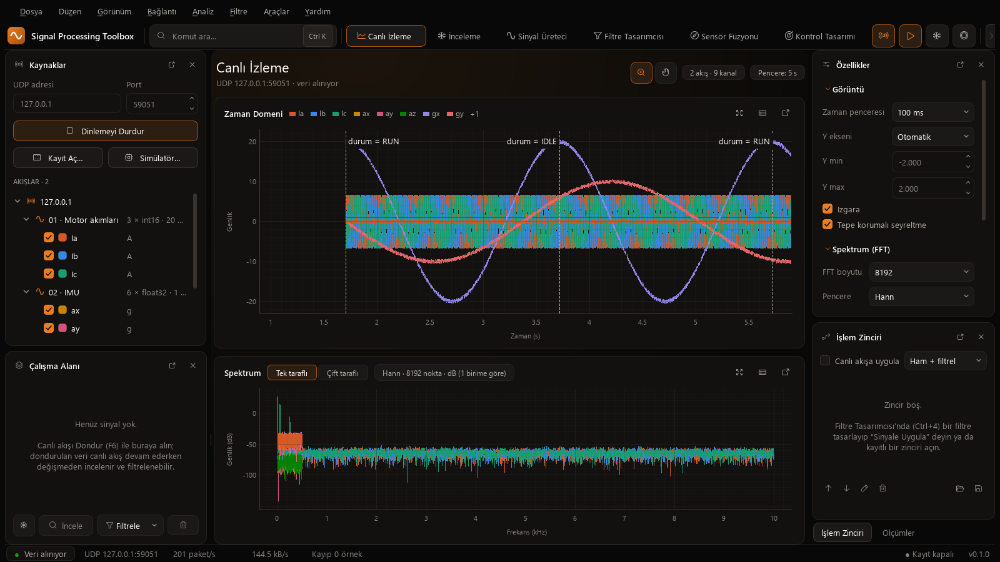

# SPTF-UDP Kullanım Kılavuzu

**Gömülü cihazdan Signal Processing Toolbox'a gerçek zamanlı UDP veri aktarımı**

| Alan | Değer |
|---|---|
| Doküman | SPT-UM-001 — Kullanım kılavuzu (IEC/IEEE 82079-1 yapısında) |
| Ürün | SPTF-UDP gömülü kütüphanesi 1.0.0 + Signal Processing Toolbox 0.1.0 |
| Tarih | 2026-10-12 |
| İlgili | [Üst seviye protokol](SPTF_UDP_Uygulama_Protokolu.md) · [Çerçeve formatı](SPTF_Protokol_v1.md) · API: `embedded/sptf_udp/docs/api/html/index.html` |

---

## İçindekiler

1. [Bu kılavuz hakkında](#1-bu-kılavuz-hakkında)
2. [Ürün tanımı](#2-ürün-tanımı)
3. [Kullanım amacı ve güvenlik](#3-kullanım-amacı-ve-güvenlik)
4. [Hızlı başlangıç (10 dakika)](#4-hızlı-başlangıç-10-dakika)
5. [Entegrasyon](#5-entegrasyon)
6. [Yapılandırma](#6-yapılandırma)
7. [Kullanım](#7-kullanım)
8. [Arayüz tarafı](#8-arayüz-tarafı)
9. [Kaynak tüketimi ve performans](#9-kaynak-tüketimi-ve-performans)
10. [Sorun giderme](#10-sorun-giderme)
11. [Doğrulama, kalite ve bakım](#11-doğrulama-kalite-ve-bakım)
- [Ek A — API özeti](#ek-a--api-özeti) · [Ek B — Durum kodları](#ek-b--durum-kodları)

---

## 1. Bu kılavuz hakkında

**Amaç.** Mikrodenetleyicinizdeki sinyalleri (ADC, IMU, kontrol çevrimi değişkenleri, I/Q …) Ethernet üzerinden
Signal Processing Toolbox'a göndermek için gereken her adımı anlatır: dosyaların projeye eklenmesi, ağ yığınına
bağlanması, akışların tanımlanması, arayüzde izleme ve sorun giderme.

**Hedef kitle.** C ve gömülü ağ yığınları (lwIP, BSD soket) bilen yazılım mühendisleri.

**Gösterimler.**

| Gösterim | Anlamı |
|---|---|
| `sptf_stream_write()` | Kod, dosya ya da menü öğesi |
| **Dinlemeyi Başlat** | Arayüzdeki düğme / menü adı |
| ⚠ **Dikkat** | Uyulmazsa veri kaybı ya da yanlış ölçüm olabilecek durum |
| ℹ **Not** | Yararlı ek bilgi |
| TAHMİN | Ölçülmemiş, hesapla bulunmuş değer |

## 2. Ürün tanımı

```
  MCU                                                           PC
 +---------------------------------------------+              +-------------------------------------+
 |  ADC / IMU / çevrim  --DMA-->  tampon       |              |  Signal Processing Toolbox          |
 |        |                                    |   UDP 50505  |   UDP alıcı süreci -> halka tampon  |
 |        v                                    |  ==========> |   Canlı İzleme · Spektrum · Kayıt   |
 |  SPTF-UDP: çerçevele, böl, say, işaretle    |   SPTF v1    |   Filtre · Füzyon · Kontrol tasarımı|
 |        |                                    |              |   MCU C kodu üretimi  ---+          |
 |  lwIP raw (sıfır kopya) / BSD soket  -> ETH |              +--------------------------|----------+
 +---------------------------------------------+                                         |
          ^------------------------------  tasarlanan kod karta geri döner  -------------+
```

**Bileşenler** (`embedded/sptf_udp/`):

| Klasör | İçerik |
|---|---|
| `include/` | `sptf.h` (genel API), `sptf_config.h` (derleme seçenekleri) |
| `src/` | `sptf_frame.c` (çerçeve kodlayıcı, CRC-32), `sptf_link.c` (akış yönetimi), `sptf_internal.h` |
| `port/lwip_raw/` | lwIP raw API portu: çerçeve doğrudan pbuf'a yazılır (sıfır kopya); çıplak metal ve RTOS |
| `port/socket/` | BSD soket portu: lwIP socket (FreeRTOS), POSIX (Linux, Zephyr), Windows Winsock |
| `examples/stm32_lwip_raw/` | STM32 + lwIP: 2 kanal ADC (DMA çift tampon) → akış, taşma işareti |
| `examples/host/` | PC'den demo / test göndericisi (kartsız deneme) |
| `test/` | Birim testleri ve Python çapraz doğrulama aracı |
| `docs/` | `Doxyfile`, API ana sayfası |

**Kütüphanenin sizin yerinize yaptıkları:** DESCRIPTOR'ı ilk yazımda ve en geç 500 ms'de bir göndermek; büyük
blokları datagram boyutuna bölmek; `seq`, `first_sample`, `desc_rev` sayaçlarını yürütmek; gönderilemeyen
örnekleri alıcıda tam uzunlukta bir boşluk olarak görünecek biçimde saymak; zaman damgası ve CRC.

**Gereksinimler.** C99 derleyici; 64 bit IEEE 754 `double` (tüm Cortex-M, RISC-V, Xtensa; AVR'de
`-mdouble=64`); lwIP 2.x ya da BSD soket API'si; dinamik bellek **gerekmez**.

## 3. Kullanım amacı ve güvenlik

**Amacına uygun kullanım:** Geliştirme, hata ayıklama ve test sırasında, **kontrollü bir ağda** (doğrudan kablo
ya da ayrılmış yerel ağ) cihazdan PC'ye tek yönlü ölçüm verisi aktarımı.

⚠ **Dikkat**
- Protokolde kimlik doğrulama ve şifreleme yoktur. İnternete ya da paylaşılan üretim ağına açmayın.
- UDP teslimat garantisi vermez. Kayıplar gizlenmez, sayılır ve grafikte boşluk olarak görünür. Güvenlik açısından
  kritik bir kontrol döngüsünü bu bağlantıya bağımlı kılmayın.
- Kütüphane fonksiyonlarını **kesme (ISR) içinden çağırmayın.** ISR yalnız "tampon hazır" bayrağı kurmalıdır.
- Bir bağlantıyı (`sptf_link_t`) ve akışlarını aynı anda tek bir görev / bağlam kullanmalıdır. Birden fazla görev
  gönderecekse aynı muteksle koruyun ya da tek bir gönderici görev kullanın.
- Ethernet hattının ve alıcının kapasitesini aşacak hızda göndermeyin (bkz. §9.3).

## 4. Hızlı başlangıç (10 dakika)

### 4.1 Önce kartsız deneyin (PC'den PC'ye)

1. Arayüzü başlatın: `run.py`. **Kaynaklar** panelinde *UDP adresi* `0.0.0.0`, *Port* `50505` → **Dinlemeyi
   Başlat** (F5).
2. Demo göndericisini derleyin (MinGW, proje kökünden):

```bash
gcc -std=c99 -O2 -Iembedded/sptf_udp/include -Iembedded/sptf_udp/port/socket embedded/sptf_udp/src/sptf_frame.c embedded/sptf_udp/src/sptf_link.c embedded/sptf_udp/port/socket/sptf_port_socket.c embedded/sptf_udp/examples/host/sptf_host_demo.c -lws2_32 -o sptf_host_demo.exe
```

3. 20 saniye gönderin:

```bash
./sptf_host_demo.exe 127.0.0.1 50505 20 demo
```

**Beklenen sonuç:** **AKIŞLAR** altında *Motor akımları* (3 × int16, 20 kHz) ve *IMU* (6 × float32, 1 kHz)
belirir. Grafikte her 2 saniyede bir `durum = RUN` / `durum = IDLE` etiketli kesikli dikey çizgi görünür, durum
çubuğunda *Kayıp 0 örnek* yazar.



### 4.2 Kartta (STM32 + lwIP, çıplak metal)

```c
#include "sptf.h"
#include "sptf_port_lwip_raw.h"

static sptf_lwip_raw_t port;
static sptf_link_t     link;
static sptf_stream_t   adc;
static const sptf_channel_t ch[2] = {
    {"Ia", "A", 3.3 / 4096.0 / 2.0, -0.825},   /* fiziksel = ham · scale + offset */
    {"Ib", "A", 3.3 / 4096.0 / 2.0, -0.825},
};
static const sptf_stream_config_t adc_cfg = {
    1u, "Motor akımları", 20000.0, SPTF_UINT16, SPTF_LAYOUT_INTERLEAVED, 2u, ch, false};

void telemetry_init(void)                      /* MX_LWIP_Init()'ten sonra */
{
    ip_addr_t pc;
    sptf_link_config_t lc = {0};
    IP_ADDR4(&pc, 192, 168, 1, 10);            /* PC'nin IP adresi */
    sptf_lwip_raw_open(&port, &pc, SPTF_UDP_PORT, 0u);
    sptf_lwip_raw_transport(&port, &lc.transport);
    sptf_link_init(&link, &lc);
    sptf_stream_init(&adc, &link, &adc_cfg);
}

/* Ana döngüde, DMA yarım / tam tamponu hazır olduğunda: */
sptf_stream_write(&adc, half_buffer, 256u, SPTF_TS_NONE);
```

Tam örnek (DMA bayrakları, D-önbellek, saat, taşma işareti): `examples/stm32_lwip_raw/sptf_app.c`.

## 5. Entegrasyon

### 5.1 Dosyalar ve derleme

1. `include/` ve kullanacağınız `port/…` klasörünü içerme yoluna ekleyin.
2. `src/sptf_frame.c`, `src/sptf_link.c` ve port kaynağını derlemeye ekleyin.
3. Önerilen bayraklar: `-std=c99 -Os -ffunction-sections -fdata-sections` (bağlayıcıda `--gc-sections`).
   Kütüphane `-Wall -Wextra -Wpedantic -Wconversion -Wsign-conversion -Werror` ile uyarısız derlenir.

### 5.2 STM32CubeIDE + lwIP, çıplak metal (`NO_SYS = 1`) — önerilen

| Adım | Ayar |
|---|---|
| 1 | CubeMX: **ETH** (RMII) ve **LWIP** etkin; statik IP ya da DHCP. `LWIP_UDP = 1` (varsayılan). |
| 2 | `MEM_SIZE`: `PBUF_RAM` tamponları lwIP yığınından gelir. Aynı anda havada olabilecek datagram sayısı × ~1.6 KB'den büyük olmalı. Cube örneklerindeki 14 KB, 1472 baytlık ~8 datagram demektir. Yüksek hızda artırın. |
| 3 | **STM32H7 / F7:** `LWIP_RAM_HEAP_POINTER` ve Ethernet tanımlayıcıları önbelleksiz bölgede olmalı (CubeMX MPU ayarı; Cube örneklerinde 0x30004000). ADC DMA tamponu DMA'nın erişebildiği RAM'de olmalı (H7'de D2 SRAM). |
| 4 | Sağlama toplamı: donanım boşaltması (`CHECKSUM_BY_HARDWARE`) ya da `CHECKSUM_GEN_UDP = 1`; ikisi de uygun. |
| 5 | `sptf_app.c`'yi ekleyin, `SPTF_APP_PC_IP`'yi PC'nizin adresine ayarlayın, `main.c`'de `sptf_app_init()` ve döngüde `sptf_app_process()` çağırın. |

ℹ **Not:** Cube'un güncel `ethernetif` sürücüsü pbuf'ı DMA gönderimi bitene kadar tutar (sıfır kopya). Eski
sürücüler kopyalar. İki durumda da port doğru çalışır.

### 5.3 FreeRTOS + lwIP

- **lwIP raw portu** `LWIP_TCPIP_CORE_LOCKING = 1` (lwIP varsayılanı) ise her çağrıda `LOCK_TCPIP_CORE()` alır;
  herhangi bir görevden çağrılabilir. Bu derleme STM32Cube H7 FreeRTOS yapılandırmasıyla doğrulanmıştır.
- **Soket portu:** `-DSPTF_SOCKET_LWIP` ile derleyin (`LWIP_SOCKET = 1`). Bir kopya fazladır ama API taşınabilirdir.
- Kilit davranışını değiştirmek için `SPTF_LWIP_LOCK()` / `SPTF_LWIP_UNLOCK()` makrolarını kendiniz tanımlayın.

### 5.4 Linux, Zephyr, Windows (PC)

`port/socket` kullanın. Windows'ta `-lws2_32` ile bağlayın; Winsock'u port kendisi başlatır.
`sptf_socket_open(&port, (const uint8_t[4]){192, 168, 1, 10}, SPTF_UDP_PORT)`.

### 5.5 Xilinx Zynq / diğer lwIP platformları

Xilinx bağımsız (standalone) lwIP de raw API'dir: `port/lwip_raw` değişiklik gerektirmez.

### 5.6 Kendi taşımanız

İki fonksiyonluk `sptf_transport_t` arayüzünü gerçekleyin:

| Fonksiyon | Sözleşme |
|---|---|
| `uint8_t *acquire(void *ctx, size_t len)` | En az `len` baytlık bitişik, yazılabilir tampon verir; yoksa `NULL`. |
| `sptf_status_t send(void *ctx, uint8_t *buf, size_t len)` | Tamponu tek datagram olarak gönderir ve **her durumda** serbest bırakır. `len == 0` ise yalnız serbest bırakır. |

Her datagram için önce bir `acquire`, sonra tam bir `send` çağrılır.

## 6. Yapılandırma

### 6.1 Derleme seçenekleri (`sptf_config.h`)

Değiştirmek için `-D` ile verin ya da `-DSPTF_USER_CONFIG_FILE="\"benim_ayarim.h\""` kullanın.

| Makro | Varsayılan | Açıklama |
|---|---|---|
| `SPTF_CFG_CRC` | 1 | CRC-32 desteği; 0 → CRC kodu imaja girmez, CRC isteyen akış reddedilir |
| `SPTF_CFG_CRC_TABLE` | 1 | 1: 1 KiB tablo (hızlı), 0: bit bit (tablosuz) |
| `SPTF_CFG_CRC32_HOOK` | — | Donanım CRC fonksiyonu (CRC-32/ISO-HDLC sonucu döndürmeli) |
| `SPTF_CFG_MAX_DATAGRAM` | 1472 | Varsayılan en büyük UDP yükü |
| `SPTF_CFG_DESCRIPTOR_PERIOD_MS` | 500 | DESCRIPTOR tekrarı (≤ 1000) |
| `SPTF_CFG_HOST_BIG_ENDIAN` | otomatik | Büyük uçlu hedefte örnekler bileşen bileşen çevrilir |
| `SPTF_CFG_ASSERT(x)` | boş | İç tutarlılık denetimi |

### 6.2 Bağlantı (`sptf_link_config_t`)

| Alan | Açıklama |
|---|---|
| `transport` | Port fonksiyonları (zorunlu) |
| `clock`, `clock_ctx` | Monoton ns saati. Yoksa zaman damgaları 0 olur, DESCRIPTOR tekrarı örnek sayısıyla yapılır. |
| `max_datagram` | 0 → 1472. Jumbo çerçeve için 8972 (yolun tamamı destekliyorsa), en fazla 65507. |
| `descriptor_period_ms` | 0 → 500 |

### 6.3 Akış (`sptf_stream_config_t`)

| Alan | Kural |
|---|---|
| `stream_id` | Cihazda benzersiz |
| `name` | UTF-8, ≤ 32 bayt |
| `sample_rate_hz` | 0.001 … 10¹² Hz, kanal başına |
| `sample_type` | 17 tip; aşağıdaki öneriler |
| `layout` | `SPTF_LAYOUT_INTERLEAVED` (önerilen, ADC tarama + DMA çıktısı) ya da `SPTF_LAYOUT_PLANAR` |
| `channel_count`, `channels` | 1 … 256 kanal (1472 B datagramda en fazla 21); kanal dizisi kopyalanmaz, `static const` tutun |
| `channels[i].scale / offset` | Fiziksel = ham · scale + offset |
| `crc` | Uçtan uca bütünlük için `true` |

**Tip seçimi:**

| Kaynak | Tip | Ölçek örneği |
|---|---|---|
| 12 / 16 bit ADC | `SPTF_UINT16` | `scale = Vref / 4096`, birim `"V"` |
| Q15 sabit noktalı | `SPTF_INT16` | `scale = 1.0 / 32768` |
| 24 bit ses ADC'si (ör. I²S) | `SPTF_INT24` | 3 bayt **paketli, küçük uçlu**; paketlemeyi siz yapın |
| IMU, kontrol değişkenleri | `SPTF_FLOAT32` | `scale = 1` |
| SDR / I/Q | `SPTF_CINT16` | I ve Q'ya ayrı ayrı uygulanır |

## 7. Kullanım

### 7.1 Başlatma sırası

`sptf_<port>_open()` → `sptf_link_init()` → `sptf_stream_init()` (her akış için). Ağ henüz hazır olmasa da
başlatma başarılı olur; ilk DESCRIPTOR ilk yazımda ya da `sptf_link_poll()`'da gider.

### 7.2 Örnek gönderme

```c
sptf_status_t st = sptf_stream_write(&adc, samples, n, SPTF_TS_AUTO);
```

- `samples`: akışın yerleşiminde, hedefin bellek düzeninde. Interleaved: `n × kanal` eleman. Planar: kanal başına
  `n` elemanlık bloklar.
- Blok tek datagrama sığmazsa kütüphane otomatik böler. Bölünmeyi önlemek için blok boyunu
  `sptf_stream_samples_per_frame(&adc)` değerine eşit ya da küçük seçin (2 × uint16 → 356).
- Zaman damgası: `SPTF_TS_NONE` (0), `SPTF_TS_AUTO` (saatten: ilk örnek = şimdi − n · Ts) ya da ilk örneğin kendi
  ölçtüğünüz zamanı (ns).
- ⚠ **Dikkat:** Hata dönerse (tampon yok, ağ hatası) gönderilemeyen örnekler kayıp sayılır ve sayaç yine ilerler.
  Aynı bloğu yeniden göndermeyin; alıcı onu yinelenen çerçeve olarak atar.

### 7.3 Olay işaretleri

```c
sptf_stream_marker(&adc, SPTF_MARKER_AT_NEXT, 0x01u, "durum = RUN", SPTF_TS_AUTO);
```

Arayüzde zaman grafiğinde etiketli kesikli dikey çizgi olarak görünür. Ayrıntısı (kod, örnek indeksi) çizginin
ipucunda ve **Günlük**'tedir. Kullanım örnekleri: durum makinesi geçişi, hata kodu, ISR taşması, parametre
değişikliği.

### 7.4 Periyodik çağrı

Veri akmasa bile akışın arayüzde tanınır kalması için ana döngüden ~100 ms'de bir:

```c
sptf_link_poll(&link);
```

### 7.5 Yeniden yapılandırma

Hız, kanal, tip ya da ölçek değişince:

```c
sptf_stream_reconfigure(&adc, &yeni_cfg);   /* stream_id aynı kalmalı */
```

`desc_rev` artar, `first_sample` 0'dan başlar, yeni DESCRIPTOR hemen gider. Arayüzde akış yeniden kurulur.

### 7.6 Birden fazla akış

Farklı hız ya da tipteki sinyaller için ayrı akış açın (ör. 20 kHz akım + 1 kHz IMU). Hepsi aynı bağlantıyı
paylaşabilir. `stream_id`'ler farklı olmalıdır.

### 7.7 Durum ve sayaçlar

`link.stats` (`datagrams`, `bytes`, `err_nomem`, `err_io`) ve `stream.stats` (`data_frames`, `samples_sent`,
`samples_dropped` …) hata ayıklayıcıdan ya da kendi telemetrinizden izlenebilir.

## 8. Arayüz tarafı

| Adım | Nerede |
|---|---|
| PC'ye kartla aynı alt ağdan statik IP verin (ör. PC 192.168.1.10/24, kart 192.168.1.20) | Windows ağ ayarları |
| Windows Güvenlik Duvarı'nda Python için **UDP 50505 gelen** trafiğine izin verin (özel ağ) | Windows Güvenlik |
| *UDP adresi* `0.0.0.0` (tüm arabirimler) ya da belirli kartın IP'si, *Port* `50505` | **Kaynaklar** paneli |
| **Dinlemeyi Başlat** (F5) | **Kaynaklar** / **Bağlantı** menüsü |
| Akışlar ve kanallar ağaçta, birim ve format ile | **AKIŞLAR** |
| Paket/s, veri hızı, kayıp örnek, "Kayıplı" rozeti | **Paket İstatistikleri** paneli, durum çubuğu |
| Ham çerçeveleri değiştirmeden kaydetme / oynatma | **Kaydı Başlat** (Ctrl+R), **Kayıt Aç…** |

ℹ **Not:** Alıcı akışı (kaynak IP, `stream_id`) ile ayırır. İki kart aynı `stream_id`'yi kullanabilir; farklı IP
yeterlidir.

## 9. Kaynak tüketimi ve performans

### 9.1 Bellek (ölçüldü)

Çekirdek kütüphane (`sptf_frame.c` + `sptf_link.c`), flash bayt; arm-none-eabi-gcc 13.3 ve Clang 19:

| Çekirdek | GCC -Os, CRC tablolu | GCC -Os, tablosuz | GCC -O2, tablolu | Clang -Os, tablolu | Clang -Os, tablosuz |
|---|---:|---:|---:|---:|---:|
| Cortex-M0+ | 4351 | 3339 | 5175 | 5350 | 4354 |
| Cortex-M3 | 4281 | 3265 | 4779 | 5404 | 4426 |
| Cortex-M4F | 4277 | 3261 | 4747 | 5492 | 4514 |
| Cortex-M7 | 4295 | 3279 | 4823 | 5328 | 4346 |
| Cortex-M33F | 4277 | 3261 | 4791 | 5492 | 4514 |

| Öğe | Değer |
|---|---|
| Portlar (GCC -Os, M7) | lwIP raw: 304 B (çıplak metal), 412 B (FreeRTOS, kilitli); soket (lwIP): 304 B |
| Statik RAM (kütüphane) | 0 B |
| Nesne başına RAM (32 bit) | `sptf_link_t` 64 B, `sptf_stream_t` 112 B, `sptf_socket_t` 1496 B (datagram tamponu dahil) |
| Yığın, en kötü zincir (GCC `-fstack-usage`) | ≤ 280 B (M3 / M4F / M7 / M33F), ≤ 296 B (M0+); port ve ağ yığını hariç |
| STM32 örneği (`sptf_app.c`) | 732 B flash; 2288 B RAM (2048 B ADC çift tamponu dahil) |

### 9.2 İşlem maliyeti (TAHMİN)

Derleyici çıktısındaki iç döngü komutlarının sayımından elde edildi, donanımda ölçülmedi:

| İş | Cortex-M4F / M7 | Cortex-M0+ |
|---|---|---|
| CRC-32 (tablolu) | ~10 çevrim/bayt (M7'de daha az) | ~15 çevrim/bayt |
| Örnek kopyası | `memcpy` (kütüphanenizin hızında) | `memcpy` |
| Çerçeve başına sabit iş (başlık, sayaçlar, port) | birkaç yüz çevrim | birkaç yüz çevrim |

lwIP ve Ethernet sürücüsünün datagram başına maliyeti bu tabloya dahil değildir ve genellikle baskındır. Ağır
yüklerde datagram sayısını azaltın: blokları datagramı dolduracak büyüklükte seçin, gerekiyorsa jumbo çerçeve
kullanın.

### 9.3 Kapasite

| Ölçü | Değer |
|---|---|
| Alıcı kapasitesi (ölçüldü, localhost, 1472 B) | 113 MB/s, ~77 000 datagram/s, kayıpsız |
| 1472 B datagramda yük verimi | %96.5 |
| Örnek: 2 × uint16 @ 20 kHz, 256'lık bloklar | 80 kB/s, 78 datagram/s |
| Örnek: 8 × int16 @ 1 MS/s | 16 MB/s, ~11 236 datagram/s |

## 10. Sorun giderme

| Belirti | Olası neden | Çözüm |
|---|---|---|
| Arayüzde hiç akış yok | Yanlış hedef IP / port; güvenlik duvarı; farklı alt ağ | `SPTF_APP_PC_IP` ve port; Windows'ta UDP 50505'e izin; `ping` ile bağlantı; Wireshark'ta `udp.port == 50505` |
| İlk saniyede "tanımlayıcı yok" sayacı artıyor | ARP çözümlemesi sırasında ilk DESCRIPTOR düşmüş olabilir; alıcı akışın ortasında başlatılmış | Normaldir; DESCRIPTOR ≤ 500 ms'de tekrarlanır. Sürekli artıyorsa `sptf_link_poll()` çağrıldığını ve ilk yazımın hata döndürmediğini denetleyin. |
| Kayıp örnekler, `err_nomem` artıyor | lwIP yığını (`MEM_SIZE`) küçük; ana döngü yavaş | `MEM_SIZE`'ı artırın; blokları büyütün (daha az datagram); `PBUF_POOL` ile karıştırmayın (port `PBUF_RAM` kullanır) |
| Kayıp var, `err_*` sıfır | Ağda (anahtar, PC) düşüş; PC aşırı yüklü | Doğrudan kablo deneyin; PC'de başka yoğun ağ trafiğini kapatın; hızı düşürün |
| Değerler anlamsız / eski | STM32H7 D-önbelleği; DMA tamponu yanlış bellekte | Göndermeden önce `SCB_InvalidateDCache_by_Addr`; tamponu D2 SRAM'e, 32 bayt hizalı koyun (örnek kod böyle) |
| Değerler ölçekli değil | `scale` / `offset` yanlış | Fiziksel = ham · scale + offset; birimi kanal tanımında verin |
| 24 bit veri bozuk | Paketleme hatası | int24: örnek başına 3 bayt, **küçük uçlu**, işaret uzatması alıcıda yapılır |
| `sptf_stream_init` → `SPTF_ERR_SIZE` | 21'den fazla kanal ya da çok büyük örnek anı | Kanalları birden fazla akışa bölün ya da jumbo datagram (`max_datagram = 8972`) |
| `SPTF_ERR_CONFIG` | Ad > 32 bayt, birim > 16 bayt, hız aralık dışı, NaN ölçek, aynı `stream_id` | Yapılandırmayı düzeltin |
| Arayüz akışı sık sık yeniden kuruyor | Yapılandırma her seferinde değişiyor (ör. `sptf_stream_reconfigure` döngüde) | Yalnız gerçekten değiştiğinde çağırın |
| İşaret çizgisi görünmüyor | İşaret, akışın ilk verisinden önce geldi ve tampon henüz yok | Alıcı ilk veriye kadar bekletir (en fazla 32); işareti verinin ardından gönderin. Zaman penceresini genişletin. |

## 11. Doğrulama, kalite ve bakım

**Kodlama standardı.** C99 (ISO/IEC 9899:1999), MISRA C:2012 ilkeleri, Doxygen yorumları; dinamik bellek,
özyineleme ve `packed` yapı yok.

**Yapılan doğrulamalar** (`tests/test_embedded_sptf.py`, proje test paketine dahil):

| Denetim | Sonuç |
|---|---|
| C birim testleri (GCC ve Clang; küçük uçlu, büyük uçlu, bit bit CRC, CRC'siz derlemeler) | 130 denetim, 0 hata |
| Python referans kodlayıcısıyla bayt bayt karşılaştırma | 68 yapılandırma (17 tip × 2 yerleşim × CRC açık / kapalı), tümü aynı |
| Gerçek UDP üzerinden uçtan uca (50 kHz × 4 kanal rampa) | Kayıpsız, tüm örnekler bit düzeyinde aynı |
| Arayüzle uçtan uca (demo göndericisi) | 2 akış, işaret çizgileri, 0 kayıp |
| Gerçek STM32Cube H7 projeleriyle derleme (lwIP 2.2.1: çıplak metal ve FreeRTOS) | `-Werror` ile temiz |
| cppcheck 2.16 (genel denetimler) / clang-tidy 19 (CERT, bugprone, clang-analyzer) | 0 bulgu |
| Doxygen (uyarı = hata) | Temiz |

**MISRA C:2012 uyum özeti** (cppcheck MISRA eklentisi; kural metinleri lisans nedeniyle araca yüklü değildir.
Sertifikasyon gerekiyorsa lisanslı bir araçla yeniden doğrulayın):

| Kapsam | Zorunlu kural ihlali | Gerekçeli sapmalar |
|---|---|---|
| Çekirdek (`src/`) | 0 | D-01 Kural 15.5 (tavsiye): erken `return`, argüman denetimlerinde okunabilirlik için. D-02 Kural 11.5 (tavsiye): `void*` örnek tamponu genel API gereği. |
| `port/lwip_raw` | 0 (lwIP başlıklarıyla analiz) | D-01, D-02 (port bağlamı `void*`) |
| `port/socket` | 1 sapma | D-03 Kural 11.3 (zorunlu): `sockaddr_in*` → `sockaddr*` dönüşümü BSD soket API'sinin gereğidir; yalnız bu porttadır. |

**Testleri ve belgeleri yeniden üretmek:**

```bash
.venv\Scripts\python -m pytest tests/test_embedded_sptf.py
```

```bash
doxygen embedded/sptf_udp/docs/Doxyfile
```

(İkinci komutu `embedded/sptf_udp` klasöründe çalıştırın; çıktı `docs/api/html/index.html`.)

**Sürümleme.** Kütüphane anlamsal sürümleme kullanır (`SPTF_LIB_VERSION_*`). Kablo biçimi SPTF v1'dir;
uyumsuz değişiklikler yeni protokol sürümüyle (`version` alanı) gelir.

**Lisans.** GNU LGPL 2.1 (proje lisansı). ℹ Statik bağlanan gömülü yazılımda LGPL, kullanıcının kütüphaneyi
değiştirip yeniden bağlayabilmesini ister. Ürününüz için bu uygun değilse lisans sahibiyle farklı bir lisans
belirleyin.

---

## Ek A — API özeti

| Fonksiyon | Görev |
|---|---|
| `sptf_link_init(link, cfg)` | Bağlantıyı (taşıma, saat, datagram boyutu) başlatır |
| `sptf_stream_init(stream, link, cfg)` | Akışı doğrular ve ekler; ilk DESCRIPTOR'ı sıraya koyar |
| `sptf_stream_write(stream, samples, n, ts)` | Örnekleri gönderir (gerekirse böler, DESCRIPTOR'ı zamanında ekler) |
| `sptf_stream_marker(stream, idx, code, text, ts)` | Olay işareti |
| `sptf_stream_reconfigure(stream, cfg)` | Yeni yapılandırma (`desc_rev` + 1) |
| `sptf_stream_deinit(stream)` | Akışı bağlantıdan çıkarır |
| `sptf_link_poll(link)` | Zamanı gelen DESCRIPTOR'ları gönderir |
| `sptf_stream_samples_per_frame(stream)` | Bir datagrama sığan örnek sayısı |
| `sptf_config_check(cfg)` | Yapılandırmayı doğrular |
| `sptf_encode_descriptor / _data / _marker(...)` | Ağsız çerçeve kodlayıcılar (dosya, UART köprüsü) |
| `sptf_crc32_update(crc, data, len)` | CRC-32/ISO-HDLC (zlib ile aynı) |
| `sptf_lwip_raw_open / _set_destination / _close / _transport` | lwIP raw portu |
| `sptf_socket_open / _set_destination / _close / _transport` | Soket portu |

## Ek B — Durum kodları

| Kod | Değer | Anlamı | Ne yapmalı |
|---|---:|---|---|
| `SPTF_OK` | 0 | Başarılı | — |
| `SPTF_ERR_ARG` | −1 | NULL / aralık dışı argüman | Çağrıyı düzeltin |
| `SPTF_ERR_CONFIG` | −2 | Geçersiz yapılandırma | §6.3 kuralları |
| `SPTF_ERR_SIZE` | −3 | Datagrama / tampona sığmıyor | Kanal / metin / datagram boyutu |
| `SPTF_ERR_NOMEM` | −4 | Taşıma tampon veremedi | `MEM_SIZE`, gönderim hızı |
| `SPTF_ERR_IO` | −5 | Gönderim hatası | Bağlantı, hedef adres |
| `SPTF_ERR_BUSY` | −6 | Geçici meşguliyet | Sonraki blokta normal sürer |
| `SPTF_ERR_STATE` | −7 | Başlatılmamış nesne | Başlatma sırası (§7.1) |
